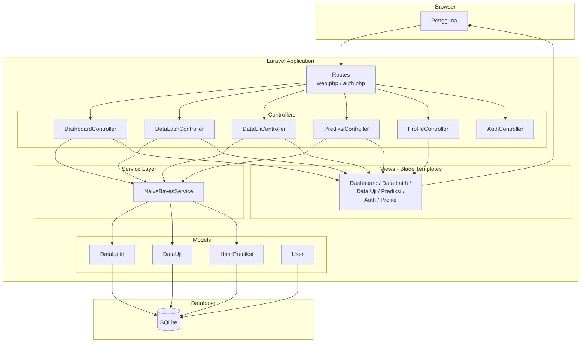
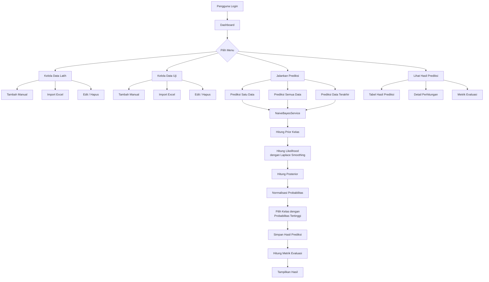
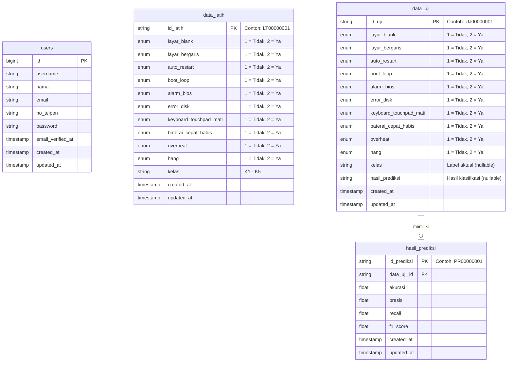

# Prediksi Kerusakan Laptop

Sistem prediksi jenis kerusakan laptop berbasis web menggunakan algoritma **Naive Bayes** dengan Laplace Smoothing. Aplikasi ini mengklasifikasikan kerusakan laptop ke dalam 5 kategori berdasarkan 10 gejala kerusakan yang diamati.

## Daftar Isi

- [Gambaran Umum](#gambaran-umum)
- [Latar Belakang dan Permasalahan](#latar-belakang-dan-permasalahan)
- [Tujuan Proyek](#tujuan-proyek)
- [Fitur Utama](#fitur-utama)
- [Technology Stack](#technology-stack)
- [Arsitektur Sistem](#arsitektur-sistem)
- [Alur Kerja Aplikasi](#alur-kerja-aplikasi)
- [Struktur Proyek](#struktur-proyek)
- [Skema Database](#skema-database)
- [Prasyarat](#prasyarat)
- [Instalasi dan Konfigurasi](#instalasi-dan-konfigurasi)
- [Konfigurasi Environment](#konfigurasi-environment)
- [Panduan Penggunaan](#panduan-penggunaan)
- [Dokumentasi Machine Learning](#dokumentasi-machine-learning)
- [Keterbatasan](#keterbatasan)
- [Pengembangan Selanjutnya](#pengembangan-selanjutnya)
- [Kontribusi](#kontribusi)
- [Lisensi](#lisensi)
- [Penulis](#penulis)

## Gambaran Umum

**Prediksi Kerusakan Laptop** adalah aplikasi web yang membantu teknisi dan pengguna umum dalam mengidentifikasi jenis kerusakan laptop berdasarkan gejala-gejala yang dialami. Sistem ini menggunakan algoritma klasifikasi **Naive Bayes** untuk memprediksi kategori kerusakan secara otomatis.

Pengguna cukup memasukkan data gejala kerusakan (seperti layar blank, overheat, boot loop, dll.), kemudian sistem akan mengklasifikasikan kerusakan tersebut ke dalam salah satu dari 5 kategori:

| Kode | Kategori Kerusakan |
|------|-------------------|
| K1 | Kerusakan RAM/Memori |
| K2 | Kerusakan Hard Disk/SSD |
| K3 | Kerusakan LCD/Layar |
| K4 | Kerusakan Sistem Operasi |
| K5 | Kerusakan akibat Overheating/Thermal |

Aplikasi ini ditujukan untuk teknisi laptop, mahasiswa yang mempelajari machine learning, serta siapa saja yang ingin mendiagnosis kerusakan laptop secara cepat.

## Latar Belakang dan Permasalahan

Diagnosis kerusakan laptop seringkali membutuhkan keahlian teknis yang mendalam. Seorang teknisi berpengalaman dapat mengenali pola gejala tertentu dan menghubungkannya dengan jenis kerusakan tertentu. Namun, proses ini memakan waktu dan bergantung pada pengalaman individu.

Permasalahan utama yang diangkat:

- Diagnosis kerusakan laptop secara manual membutuhkan keahlian khusus dan waktu yang tidak sedikit.
- Tidak semua pengguna memiliki akses ke teknisi berpengalaman.
- Pola hubungan antara gejala dan jenis kerusakan dapat dipelajari secara sistematis menggunakan teknik klasifikasi.

Proyek ini memanfaatkan algoritma Naive Bayes untuk membangun sistem yang dapat mempelajari pola tersebut dari data latih, kemudian menggunakannya untuk memprediksi kerusakan pada data baru.

## Tujuan Proyek

1. Membangun sistem klasifikasi kerusakan laptop menggunakan algoritma Naive Bayes.
2. Menyediakan antarmuka web yang memudahkan pengelolaan data latih dan data uji.
3. Menghasilkan prediksi jenis kerusakan beserta probabilitas untuk setiap kategori.
4. Menyediakan metrik evaluasi (akurasi, presisi, recall, F1-score) untuk mengukur performa model.
5. Mendukung import data secara massal melalui file Excel.

## Fitur Utama

### Manajemen Data Latih
- CRUD (Create, Read, Update, Delete) data latih secara individual.
- Import data latih secara massal dari file Excel (`.xlsx`, `.xls`).
- Download template Excel dengan format yang sudah disesuaikan.
- Hapus seluruh data latih sekaligus (truncate).

### Manajemen Data Uji
- CRUD data uji secara individual.
- Import data uji secara massal dari file Excel.
- Download template Excel untuk data uji.
- Hapus seluruh data uji beserta hasil prediksinya.

### Prediksi Kerusakan
- **Prediksi Satu Data**: Memprediksi satu data uji tertentu.
- **Prediksi Semua Data**: Menjalankan prediksi untuk seluruh data uji sekaligus.
- **Prediksi Data Terakhir**: Memprediksi hanya data uji yang baru dimasukkan (berdasarkan tanggal terakhir).
- **Detail Perhitungan**: Menampilkan langkah-langkah perhitungan Naive Bayes secara transparan (prior, likelihood, posterior) untuk setiap prediksi.

### Dashboard dan Evaluasi
- Ringkasan jumlah data latih, data uji, dan total prediksi.
- Grafik perbandingan kelas aktual vs. kelas prediksi.
- Metrik evaluasi: akurasi, presisi (macro-average), recall (macro-average), dan F1-score.
- Daftar prediksi terbaru.

### Autentikasi Pengguna
- Registrasi dan login pengguna.
- Manajemen profil (update informasi dan password).
- Seluruh fitur dilindungi oleh middleware autentikasi.

## Technology Stack

| Kategori | Teknologi | Versi | Keterangan |
|----------|-----------|-------|------------|
| **Backend** | PHP | ≥ 8.2 | Bahasa pemrograman utama |
| **Framework** | Laravel | 12.x | Framework PHP full-stack |
| **Database** | SQLite | - | Database ringan berbasis file, tidak memerlukan server terpisah |
| **Frontend CSS** | Tailwind CSS | 4.x | Framework CSS utility-first |
| **Build Tool** | Vite | 7.x | Bundler dan dev server untuk aset frontend |
| **Spreadsheet** | PhpSpreadsheet | 5.x | Library untuk membaca dan menulis file Excel |
| **Machine Learning** | Naive Bayes (custom) | - | Implementasi algoritma klasifikasi langsung dalam PHP |
| **Testing** | PHPUnit | 11.x | Framework pengujian PHP |

**Catatan penting**: Algoritma Naive Bayes diimplementasikan langsung dalam kode PHP (`NaiveBayesService`), bukan menggunakan library machine learning eksternal.

## Arsitektur Sistem

Aplikasi ini menggunakan arsitektur **MVC (Model-View-Controller)** dari Laravel, dengan tambahan **Service Layer** untuk logika bisnis Naive Bayes.



### Penjelasan Komponen

- **Routes**: Mendefinisikan URL dan mengarahkan request ke controller yang sesuai.
- **Controllers**: Menangani logika request-response untuk setiap fitur (dashboard, data latih, data uji, prediksi, profil, autentikasi).
- **NaiveBayesService**: Service layer yang mengenkapsulasi seluruh logika algoritma Naive Bayes, termasuk perhitungan prior, likelihood, posterior, dan metrik evaluasi.
- **Models**: Representasi tabel database menggunakan Eloquent ORM.
- **Views**: Template Blade yang merender antarmuka pengguna.
- **SQLite**: Database berbasis file yang menyimpan seluruh data aplikasi.

## Alur Kerja Aplikasi



## Struktur Proyek

```
prediksi-kerusakan-laptop/
├── app/
│   ├── Http/
│   │   ├── Controllers/
│   │   │   ├── Auth/                  # Controller autentikasi (Laravel Breeze)
│   │   │   ├── AuthController.php     # Controller login/register custom
│   │   │   ├── DashboardController.php
│   │   │   ├── DataLatihController.php
│   │   │   ├── DataUjiController.php
│   │   │   ├── PrediksiController.php
│   │   │   └── ProfileController.php
│   │   └── Requests/                  # Form request validation
│   ├── Models/
│   │   ├── DataLatih.php              # Model data latih (training data)
│   │   ├── DataUji.php                # Model data uji (test data)
│   │   ├── HasilPrediksi.php          # Model hasil prediksi
│   │   └── User.php                   # Model pengguna
│   ├── Providers/                     # Service providers
│   └── Services/
│       └── NaiveBayesService.php      # Implementasi algoritma Naive Bayes
├── database/
│   ├── database.sqlite                # File database SQLite
│   ├── migrations/                    # Skema tabel database
│   └── seeders/                       # Data awal (seeder)
├── resources/
│   └── views/
│       ├── auth/                      # Halaman login, register, dll.
│       ├── components/                # Komponen Blade reusable
│       ├── data-latih/                # Halaman kelola data latih
│       ├── data-uji/                  # Halaman kelola data uji
│       ├── layouts/                   # Layout utama (app, guest, navigation)
│       ├── prediksi/                  # Halaman hasil prediksi & detail
│       ├── profile/                   # Halaman profil pengguna
│       ├── dashboard.blade.php        # Halaman dashboard
│       └── welcome.blade.php          # Halaman landing page
├── routes/
│   ├── auth.php                       # Route autentikasi
│   └── web.php                        # Route utama aplikasi
├── public/                            # Aset publik (favicon, index.php)
├── .env.example                       # Template konfigurasi environment
├── composer.json                      # Dependensi PHP
├── package.json                       # Dependensi Node.js
└── vite.config.js                     # Konfigurasi Vite + Tailwind CSS
```

## Skema Database

Aplikasi ini menggunakan 4 tabel utama (selain tabel bawaan Laravel untuk cache, session, dan jobs).



### Penjelasan Tabel

| Tabel | Keterangan |
|-------|------------|
| `users` | Menyimpan data pengguna yang dapat mengakses sistem (username, nama, email, no. telepon). |
| `data_latih` | Menyimpan data training dengan 10 atribut gejala (bernilai 1 atau 2) dan label kelas (K1–K5). |
| `data_uji` | Menyimpan data testing dengan struktur sama seperti data latih, ditambah kolom `hasil_prediksi` untuk menyimpan hasil klasifikasi. |
| `hasil_prediksi` | Menyimpan relasi prediksi ke data uji, serta menyimpan metrik evaluasi global (record dengan `id_prediksi = 'METRIK'`). |

## Prasyarat

Pastikan perangkat lunak berikut sudah terinstal:

| Software | Versi Minimum | Cara Cek |
|----------|--------------|----------|
| PHP | 8.2 | `php -v` |
| Composer | 2.x | `composer -V` |
| Node.js | 18.x (disarankan) | `node -v` |
| npm | 9.x (disarankan) | `npm -v` |
| Git | - | `git --version` |

**Ekstensi PHP yang diperlukan** (umumnya sudah aktif di instalasi PHP standar):
- `pdo_sqlite`
- `mbstring`
- `openssl`
- `tokenizer`
- `xml`
- `ctype`
- `json`
- `fileinfo`
- `zip` (diperlukan oleh PhpSpreadsheet)
- `gd` (diperlukan oleh PhpSpreadsheet)

## Instalasi dan Konfigurasi

### Metode Cepat (Otomatis)

Proyek ini menyediakan script `composer setup` yang menjalankan seluruh proses instalasi secara otomatis:

```bash
# 1. Clone repository
git clone https://github.com/farhanrbagask/prediksi-kerusakan-laptop.git

# 2. Masuk ke direktori proyek
cd prediksi-kerusakan-laptop

# 3. Jalankan setup otomatis
composer setup
```

Script `composer setup` akan menjalankan langkah-langkah berikut secara berurutan:
1. `composer install` — Menginstal dependensi PHP.
2. Menyalin `.env.example` ke `.env` (jika belum ada).
3. `php artisan key:generate` — Membuat application key.
4. `php artisan migrate --force` — Menjalankan migrasi database.
5. `npm install` — Menginstal dependensi Node.js.
6. `npm run build` — Melakukan build aset frontend.

### Metode Manual (Langkah per Langkah)

Jika ingin menjalankan instalasi secara manual:

```bash
# 1. Clone repository
git clone https://github.com/farhanrbagask/prediksi-kerusakan-laptop.git

# 2. Masuk ke direktori proyek
cd prediksi-kerusakan-laptop

# 3. Instal dependensi PHP
composer install

# 4. Salin file konfigurasi environment
cp .env.example .env

# 5. Generate application key
php artisan key:generate

# 6. Jalankan migrasi database (SQLite akan dibuat otomatis)
php artisan migrate

# 7. Instal dependensi Node.js
npm install

# 8. Build aset frontend
npm run build
```

### Menjalankan Aplikasi

#### Mode Development (Direkomendasikan untuk Pengembangan)

Gunakan perintah `composer dev` untuk menjalankan semua layanan secara bersamaan:

```bash
composer dev
```

Perintah ini menjalankan 4 proses secara paralel menggunakan `concurrently`:

| Proses | Perintah | Keterangan |
|--------|----------|------------|
| **server** | `php artisan serve` | Server PHP bawaan Laravel |
| **queue** | `php artisan queue:listen` | Worker antrian database |
| **logs** | `php artisan pail` | Menampilkan log secara real-time |
| **vite** | `npm run dev` | Vite dev server dengan hot reload |

Aplikasi akan tersedia di: **http://localhost:8000**

#### Mode Manual

Jika lebih memilih menjalankan layanan secara terpisah, buka beberapa terminal:

```bash
# Terminal 1: Jalankan server Laravel
php artisan serve

# Terminal 2: Jalankan Vite dev server
npm run dev
```

### Verifikasi Instalasi

1. Buka browser dan akses `http://localhost:8000`.
2. Halaman landing page (welcome) seharusnya tampil.
3. Lakukan registrasi akun baru melalui halaman `/register`.
4. Setelah registrasi berhasil, sistem akan mengarahkan ke halaman dashboard.

## Konfigurasi Environment

File `.env.example` menyediakan template konfigurasi. Berikut variabel-variabel penting:

| Variabel | Nilai Default | Keterangan |
|----------|---------------|------------|
| `APP_NAME` | `Laravel` | Nama aplikasi |
| `APP_ENV` | `local` | Mode environment (`local`, `production`) |
| `APP_DEBUG` | `true` | Aktifkan mode debug (set `false` untuk production) |
| `APP_URL` | `http://localhost` | URL dasar aplikasi |
| `DB_CONNECTION` | `sqlite` | Driver database yang digunakan |
| `SESSION_DRIVER` | `database` | Penyimpanan session |
| `QUEUE_CONNECTION` | `database` | Driver antrian |
| `CACHE_STORE` | `database` | Penyimpanan cache |

Database SQLite tidak memerlukan konfigurasi `DB_HOST`, `DB_PORT`, `DB_DATABASE`, `DB_USERNAME`, atau `DB_PASSWORD`. File database akan otomatis dibuat di `database/database.sqlite`.

## Panduan Penggunaan

### 1. Registrasi dan Login

1. Akses halaman registrasi di `/register`.
2. Isi formulir registrasi (username, nama, email, no. telepon, password).
3. Setelah registrasi berhasil, Anda akan langsung masuk ke dashboard.
4. Untuk login berikutnya, gunakan halaman `/login`.

### 2. Menambahkan Data Latih

Data latih adalah data historis yang sudah diketahui jenis kerusakannya. Data ini digunakan untuk melatih algoritma Naive Bayes.

**Cara menambah data manual:**
1. Buka menu **Data Latih**.
2. Klik tombol tambah data.
3. Isi setiap gejala dengan nilai **1** (Tidak mengalami) atau **2** (Ya, mengalami).
4. Pilih kelas kerusakan (K1–K5).
5. Simpan data.

**Cara import dari Excel:**
1. Buka menu **Data Latih**.
2. Download template Excel terlebih dahulu (untuk memastikan format yang benar).
3. Isi template sesuai petunjuk yang tertera di dalamnya.
4. Upload file Excel yang sudah diisi.

### 3. Menambahkan Data Uji

Data uji adalah data baru yang ingin diprediksi jenis kerusakannya. Kolom kelas pada data uji berfungsi sebagai label aktual untuk keperluan evaluasi.

Prosedur penambahan data uji sama dengan data latih (manual atau import Excel).

### 4. Menjalankan Prediksi

1. Buka menu **Data Uji**.
2. Pilih salah satu opsi prediksi:
   - **Prediksi Satu**: Klik tombol prediksi pada baris data tertentu.
   - **Prediksi Semua**: Jalankan prediksi untuk seluruh data uji.
   - **Prediksi Terakhir**: Prediksi hanya data yang baru saja di-import.
3. Hasil prediksi akan muncul pada kolom `hasil_prediksi` di tabel data uji.

### 5. Melihat Detail Perhitungan

1. Buka menu **Prediksi**.
2. Pilih data yang sudah diprediksi.
3. Klik tombol **Detail Perhitungan** untuk melihat langkah-langkah perhitungan Naive Bayes:
   - Probabilitas prior setiap kelas.
   - Probabilitas likelihood setiap atribut terhadap setiap kelas.
   - Probabilitas posterior (prior × likelihood).
   - Probabilitas ternormalisasi.
   - Kelas terpilih (probabilitas tertinggi).

### 6. Melihat Metrik Evaluasi

Dashboard dan halaman prediksi menampilkan metrik evaluasi model:
- **Akurasi**: Persentase prediksi yang benar dari total prediksi.
- **Presisi**: Rata-rata presisi per kelas (macro-average).
- **Recall**: Rata-rata recall per kelas (macro-average).
- **F1-Score**: Harmonic mean dari presisi dan recall.

Metrik ini dihitung secara otomatis setelah prediksi dilakukan dan dibandingkan dengan label aktual pada data uji.

## Dokumentasi Machine Learning

### Dataset

Data yang digunakan berupa data gejala kerusakan laptop dengan format biner:
- **Jumlah atribut (fitur)**: 10 gejala kerusakan
- **Jumlah kelas**: 5 kategori kerusakan
- **Format nilai atribut**: `1` (Tidak mengalami gejala) atau `2` (Ya, mengalami gejala)

#### Daftar Atribut (Gejala)

| Kode | Atribut | Deskripsi |
|------|---------|-----------|
| X1 | `layar_blank` | Layar tidak menampilkan gambar (gelap/blank) |
| X2 | `layar_bergaris` | Muncul garis-garis aneh (horizontal/vertikal) di layar |
| X3 | `auto_restart` | Laptop tiba-tiba mati atau restart sendiri |
| X4 | `boot_loop` | Laptop tidak bisa masuk Windows (boot loop) |
| X5 | `alarm_bios` | Terdengar suara bip berulang saat dihidupkan (alarm BIOS) |
| X6 | `error_disk` | Terdapat pesan eror terkait disk atau boot |
| X7 | `keyboard_touchpad_mati` | Keyboard atau touchpad tidak berfungsi sebagian/total |
| X8 | `baterai_cepat_habis` | Baterai cepat habis atau tidak bisa diisi daya |
| X9 | `overheat` | Laptop terasa sangat panas (overheating) |
| X10 | `hang` | Performa sangat lambat atau sering hang |

### Algoritma Naive Bayes

Implementasi menggunakan **Naive Bayes** dengan **Laplace Smoothing** (additive smoothing). Seluruh logika terdapat di `app/Services/NaiveBayesService.php`.

#### Rumus yang Digunakan

**1. Probabilitas Prior Kelas**

```
P(Kelas) = (Jumlah data kelas + 1) / (Total data latih + Jumlah kelas)
```

Laplace smoothing diterapkan dengan menambahkan 1 pada pembilang dan jumlah kelas (5) pada penyebut.

**2. Probabilitas Likelihood (Per Atribut)**

```
P(Atribut = nilai | Kelas) = (Jumlah data dengan atribut = nilai pada kelas + 1) / (Total data pada kelas + 2)
```

Laplace smoothing diterapkan dengan menambahkan 1 pada pembilang dan 2 (jumlah variasi nilai: 1 dan 2) pada penyebut.

**3. Probabilitas Posterior**

```
P(Kelas | X1, X2, ..., X10) ∝ P(Kelas) × ∏ P(Xi | Kelas)
```

Posterior dihitung sebagai perkalian prior kelas dengan likelihood semua atribut.

**4. Normalisasi**

```
P_normalized(Kelas) = P(Kelas | X) / ∑ P(semua Kelas | X)
```

Posterior dinormalisasi sehingga total probabilitas semua kelas berjumlah 1.

**5. Klasifikasi**

Kelas dengan probabilitas posterior ternormalisasi tertinggi dipilih sebagai hasil prediksi.

### Metrik Evaluasi

Metrik dihitung berdasarkan perbandingan antara label aktual (`kelas`) dan hasil prediksi (`hasil_prediksi`) pada data uji:

| Metrik | Rumus | Keterangan |
|--------|-------|------------|
| **Akurasi** | Total benar / Total data | Proporsi prediksi yang tepat |
| **Presisi** | Macro-average dari TP / (TP + FP) per kelas | Ketepatan prediksi positif |
| **Recall** | Macro-average dari TP / (TP + FP) per kelas | Cakupan data positif yang terdeteksi |
| **F1-Score** | 2 × (Presisi × Recall) / (Presisi + Recall) | Harmonic mean presisi dan recall |

Metrik evaluasi disimpan di tabel `hasil_prediksi` dengan `id_prediksi = 'METRIK'` dan diperbarui setiap kali prediksi dijalankan.

## Keterbatasan

1. **Asumsi independensi**: Naive Bayes mengasumsikan semua atribut (gejala) saling independen, yang dalam kasus nyata tidak selalu berlaku. Misalnya, overheat dan auto restart bisa saling berkaitan.
2. **Fitur biner**: Atribut hanya mendukung 2 nilai (ada/tidak ada gejala). Tingkat keparahan gejala tidak diperhitungkan.
3. **5 kategori tetap**: Sistem hanya mengenali 5 jenis kerusakan yang sudah ditentukan. Kerusakan di luar kategori tersebut tidak dapat diidentifikasi.
4. **Ketergantungan pada kualitas data latih**: Akurasi prediksi sangat bergantung pada jumlah dan kualitas data latih yang dimasukkan.
5. **Single user model**: Tidak ada pemisahan data antar pengguna — semua pengguna berbagi data latih dan data uji yang sama.
6. **SQLite**: Database SQLite cocok untuk pengembangan dan penggunaan skala kecil, namun tidak ideal untuk akses konkuren yang tinggi.

## Pengembangan Selanjutnya

Berikut beberapa ide pengembangan yang dapat dilakukan:

- Menambahkan algoritma klasifikasi lain (Decision Tree, KNN, SVM) untuk perbandingan.
- Mendukung atribut dengan lebih dari 2 nilai (multi-valued attributes).
- Menambahkan fitur export hasil prediksi ke Excel/PDF.
- Mengimplementasikan role-based access control (admin vs. user biasa).
- Migrasi ke database MySQL/PostgreSQL untuk skalabilitas yang lebih baik.
- Menambahkan visualisasi confusion matrix.
- Mendukung upload dataset dalam format CSV.

## Kontribusi

Kontribusi terhadap proyek ini sangat diapresiasi. Berikut langkah-langkah untuk berkontribusi:

1. **Fork** repository ini.
2. Buat branch baru untuk fitur atau perbaikan Anda:
   ```bash
   git checkout -b fitur/nama-fitur
   ```
3. Lakukan perubahan dan commit:
   ```bash
   git commit -m "Menambahkan fitur: deskripsi singkat"
   ```
4. Push ke branch Anda:
   ```bash
   git push origin fitur/nama-fitur
   ```
5. Buat **Pull Request** ke branch utama repository ini.

### Melaporkan Bug atau Saran

Gunakan fitur **Issues** di GitHub untuk melaporkan bug atau mengajukan saran perbaikan. Sertakan:
- Deskripsi masalah yang jelas.
- Langkah-langkah untuk mereproduksi masalah.
- Versi PHP dan Node.js yang digunakan.

## Lisensi

Repository ini saat ini **tidak menyertakan file lisensi**. Hubungi pemilik repository untuk informasi lebih lanjut mengenai izin penggunaan kode.

Framework Laravel yang digunakan sebagai basis proyek ini berlisensi [MIT License](https://opensource.org/licenses/MIT).

## Penulis

- **GitHub**: [farhanrbagask](https://github.com/farhanrbagask)
- **Repository**: [prediksi-kerusakan-laptop](https://github.com/farhanrbagask/prediksi-kerusakan-laptop)
