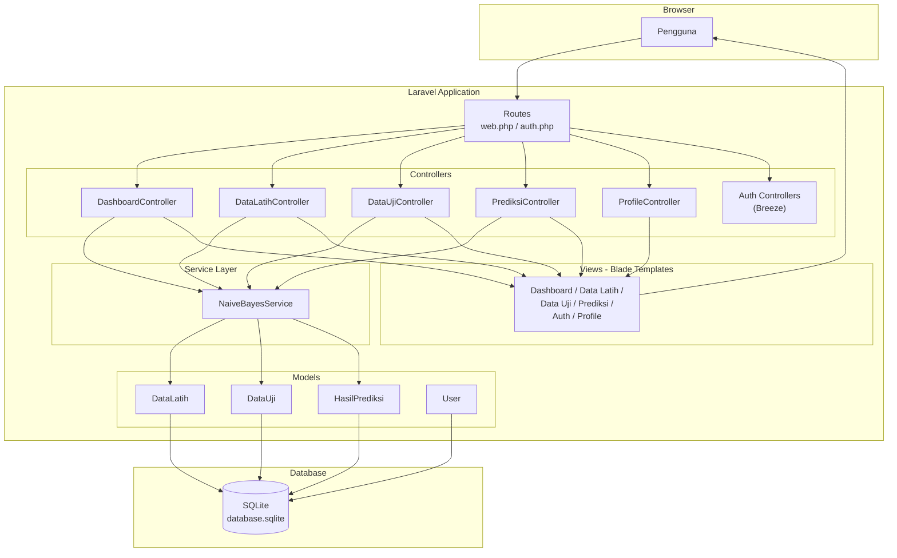
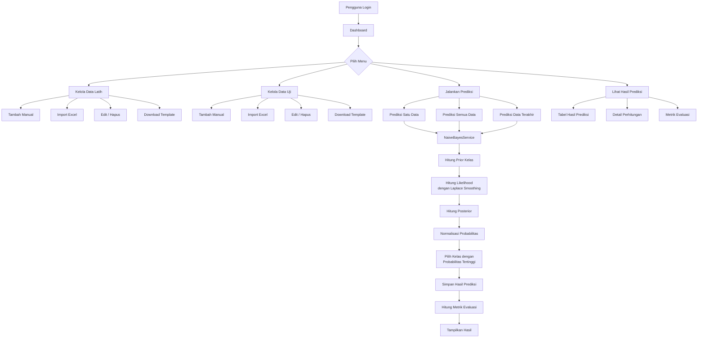
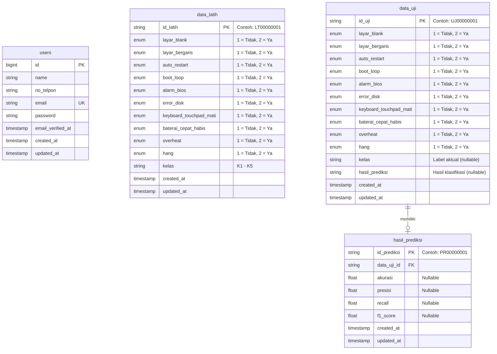

# Prediksi Kerusakan Laptop

Sistem prediksi jenis kerusakan laptop berbasis web menggunakan algoritma **Naive Bayes** dengan Laplace Smoothing. Aplikasi ini mengklasifikasikan kerusakan laptop ke dalam 5 kategori berdasarkan 10 gejala kerusakan yang diamati.

## Daftar Isi

- [Gambaran Umum](#gambaran-umum)
- [Latar Belakang dan Permasalahan](#latar-belakang-dan-permasalahan)
- [Tujuan Proyek](#tujuan-proyek)
- [Fitur Utama](#fitur-utama)
- [Technology Stack](#technology-stack)
- [Arsitektur Sistem](#arsitektur-sistem)
- [Alur Kerja Aplikasi](#alur-kerja-aplikasi)
- [Struktur Proyek](#struktur-proyek)
- [Skema Database](#skema-database)
- [Prasyarat](#prasyarat)
- [Instalasi dan Konfigurasi](#instalasi-dan-konfigurasi)
- [Konfigurasi Environment](#konfigurasi-environment)
- [Panduan Penggunaan](#panduan-penggunaan)
- [Dokumentasi Machine Learning](#dokumentasi-machine-learning)
- [Keterbatasan](#keterbatasan)
- [Pengembangan Selanjutnya](#pengembangan-selanjutnya)
- [Kontribusi](#kontribusi)
- [Lisensi](#lisensi)
- [Penulis](#penulis)

## Gambaran Umum

**Prediksi Kerusakan Laptop** adalah aplikasi web yang membantu teknisi dan pengguna umum dalam mengidentifikasi jenis kerusakan laptop berdasarkan gejala-gejala yang dialami. Sistem ini menggunakan algoritma klasifikasi **Naive Bayes** untuk memprediksi kategori kerusakan secara otomatis.

Pengguna cukup memasukkan data gejala kerusakan (seperti layar blank, overheat, boot loop, dll.), kemudian sistem akan mengklasifikasikan kerusakan tersebut ke dalam salah satu dari 5 kategori:

| Kode | Kategori Kerusakan |
|------|-------------------|
| K1 | Kerusakan RAM/Memori |
| K2 | Kerusakan Hard Disk/SSD |
| K3 | Kerusakan LCD/Layar |
| K4 | Kerusakan Sistem Operasi |
| K5 | Kerusakan akibat Overheating/Thermal |

Aplikasi ini ditujukan untuk teknisi laptop, mahasiswa yang mempelajari machine learning, serta siapa saja yang ingin mendiagnosis kerusakan laptop secara cepat.

## Latar Belakang dan Permasalahan

Diagnosis kerusakan laptop seringkali membutuhkan keahlian teknis yang mendalam. Seorang teknisi berpengalaman dapat mengenali pola gejala tertentu dan menghubungkannya dengan jenis kerusakan tertentu. Namun, proses ini memakan waktu dan bergantung pada pengalaman individu.

Permasalahan utama yang diangkat:

- Diagnosis kerusakan laptop secara manual membutuhkan keahlian khusus dan waktu yang tidak sedikit.
- Tidak semua pengguna memiliki akses ke teknisi berpengalaman.
- Pola hubungan antara gejala dan jenis kerusakan dapat dipelajari secara sistematis menggunakan teknik klasifikasi.

Proyek ini memanfaatkan algoritma Naive Bayes untuk membangun sistem yang dapat mempelajari pola tersebut dari data latih, kemudian menggunakannya untuk memprediksi kerusakan pada data baru.

## Tujuan Proyek

1. Membangun sistem klasifikasi kerusakan laptop menggunakan algoritma Naive Bayes.
2. Menyediakan antarmuka web yang memudahkan pengelolaan data latih dan data uji.
3. Menghasilkan prediksi jenis kerusakan beserta probabilitas untuk setiap kategori.
4. Menyediakan metrik evaluasi (akurasi, presisi, recall, F1-score) untuk mengukur performa model.
5. Mendukung import data secara massal melalui file Excel.

## Fitur Utama

### Manajemen Data Latih

- CRUD (Create, Read, Update, Delete) data latih secara individual.
- Import data latih secara massal dari file Excel (`.xlsx`, `.xls`).
- Download template Excel dengan format yang sudah disesuaikan beserta petunjuk pengisian.
- Hapus seluruh data latih sekaligus (truncate).
- Paginasi data (10 data per halaman).

### Manajemen Data Uji

- CRUD data uji secara individual.
- Import data uji secara massal dari file Excel.
- Download template Excel untuk data uji.
- Hapus seluruh data uji beserta hasil prediksinya.

### Prediksi Kerusakan

- **Prediksi Satu Data**: Memprediksi satu data uji tertentu berdasarkan ID.
- **Prediksi Semua Data**: Menjalankan prediksi untuk seluruh data uji sekaligus dan menampilkan akurasi keseluruhan.
- **Prediksi Data Terakhir**: Memprediksi hanya data uji yang baru dimasukkan (berdasarkan tanggal `created_at` terakhir), melewati data yang sudah diprediksi sebelumnya.
- **Detail Perhitungan**: Menampilkan langkah-langkah perhitungan Naive Bayes secara transparan (prior, likelihood per atribut, posterior, normalisasi) untuk setiap prediksi.

### Dashboard dan Evaluasi

- Ringkasan jumlah data latih, data uji, dan total prediksi.
- Grafik perbandingan distribusi kelas aktual vs. kelas prediksi (menggunakan Chart.js).
- Metrik evaluasi: akurasi, presisi (macro-average), recall (macro-average), dan F1-score.
- Daftar 5 prediksi terbaru.

### Autentikasi Pengguna

- Registrasi pengguna (username, nama, email, nomor telepon, password).
- Login dan logout.
- Manajemen profil (update informasi dan password).
- Seluruh fitur utama dilindungi oleh middleware autentikasi.

## Technology Stack

| Kategori | Teknologi | Versi | Keterangan |
|----------|-----------|-------|------------|
| **Backend** | PHP | ≥ 8.2 | Bahasa pemrograman utama |
| **Framework** | Laravel | 12.x | Framework PHP full-stack dengan arsitektur MVC |
| **Database** | SQLite | - | Database ringan berbasis file, tidak memerlukan server terpisah |
| **Frontend CSS** | Tailwind CSS | 4.x | Framework CSS utility-first untuk styling responsif |
| **Build Tool** | Vite | 7.x | Bundler dan dev server untuk aset frontend dengan hot reload |
| **Spreadsheet** | PhpSpreadsheet | 5.x | Library untuk membaca dan menulis file Excel (import/export data) |
| **Chart** | Chart.js | (CDN) | Library JavaScript untuk visualisasi grafik pada dashboard |
| **Machine Learning** | Naive Bayes (custom) | - | Implementasi algoritma klasifikasi langsung dalam PHP |
| **Testing** | PHPUnit | 11.x | Framework pengujian PHP |

**Catatan penting**: Algoritma Naive Bayes diimplementasikan langsung dalam kode PHP (`NaiveBayesService`), bukan menggunakan library machine learning eksternal.

## Arsitektur Sistem

Aplikasi ini menggunakan arsitektur **MVC (Model-View-Controller)** dari Laravel, dengan tambahan **Service Layer** untuk logika bisnis Naive Bayes.



### Penjelasan Komponen

| Komponen | Tanggung Jawab |
|----------|---------------|
| **Routes** (`web.php`, `auth.php`) | Mendefinisikan URL dan mengarahkan request ke controller yang sesuai. Semua route utama dilindungi middleware `auth`. |
| **DashboardController** | Mengambil statistik ringkasan, distribusi kelas, grafik perbandingan aktual vs. prediksi, dan metrik evaluasi. |
| **DataLatihController** | CRUD data latih, import dari Excel, download template, dan truncate. |
| **DataUjiController** | CRUD data uji, import dari Excel, download template, truncate, dan prediksi data terakhir. |
| **PrediksiController** | Menjalankan prediksi (satu/semua), menampilkan hasil, dan menghitung detail perhitungan per data uji. |
| **NaiveBayesService** | Service layer yang mengenkapsulasi seluruh logika algoritma Naive Bayes: perhitungan prior, likelihood, posterior, normalisasi, metrik evaluasi, dan auto-generate ID. |
| **Models** | Representasi tabel database menggunakan Eloquent ORM. `DataUji` memiliki relasi `hasOne` ke `HasilPrediksi`. |
| **Views** | Template Blade yang merender antarmuka pengguna dengan tema gelap dan desain responsif. |
| **SQLite** | Database berbasis file yang menyimpan seluruh data aplikasi di `database/database.sqlite`. |

## Alur Kerja Aplikasi



### Alur Prediksi (Detail)

1. Pengguna memilih data uji yang ingin diprediksi (satu, semua, atau data terakhir).
2. `PrediksiController` memanggil `NaiveBayesService::prediksiSatuData()`.
3. Service menghitung **probabilitas prior** setiap kelas berdasarkan distribusi data latih.
4. Untuk setiap kelas, service menghitung **likelihood** setiap atribut gejala menggunakan Laplace Smoothing.
5. **Posterior** dihitung sebagai perkalian prior dengan semua likelihood.
6. Posterior **dinormalisasi** sehingga jumlah probabilitas semua kelas = 1.
7. Kelas dengan probabilitas tertinggi dipilih sebagai **hasil prediksi**.
8. Hasil disimpan ke kolom `hasil_prediksi` di tabel `data_uji` dan record baru dibuat di tabel `hasil_prediksi`.
9. **Metrik evaluasi** (akurasi, presisi, recall, F1-score) dihitung ulang dan disimpan.

## Struktur Proyek

```
prediksi-kerusakan-laptop/
├── app/
│   ├── Http/
│   │   ├── Controllers/
│   │   │   ├── Auth/                  # Controller autentikasi (Laravel Breeze)
│   │   │   ├── DashboardController.php
│   │   │   ├── DataLatihController.php
│   │   │   ├── DataUjiController.php
│   │   │   ├── PrediksiController.php
│   │   │   └── ProfileController.php
│   │   └── Requests/                  # Form request validation
│   ├── Models/
│   │   ├── DataLatih.php              # Model data latih (training data)
│   │   ├── DataUji.php                # Model data uji (test data)
│   │   ├── HasilPrediksi.php          # Model hasil prediksi & metrik evaluasi
│   │   └── User.php                   # Model pengguna
│   ├── Providers/                     # Service providers
│   └── Services/
│       └── NaiveBayesService.php      # Implementasi algoritma Naive Bayes
├── database/
│   ├── database.sqlite                # File database SQLite (dibuat saat migrasi)
│   ├── migrations/                    # Skema tabel database
│   └── seeders/                       # Data awal (seeder)
├── resources/
│   └── views/
│       ├── auth/                      # Halaman login, register, dll.
│       ├── components/                # Komponen Blade reusable
│       ├── data-latih/                # Halaman kelola data latih
│       ├── data-uji/                  # Halaman kelola data uji
│       ├── layouts/                   # Layout utama (app, guest, navigation)
│       ├── prediksi/                  # Halaman hasil prediksi & detail perhitungan
│       ├── profile/                   # Halaman profil pengguna
│       ├── dashboard.blade.php        # Halaman dashboard dengan grafik
│       └── welcome.blade.php          # Halaman landing page
├── routes/
│   ├── auth.php                       # Route autentikasi
│   └── web.php                        # Route utama aplikasi
├── public/                            # Aset publik (favicon, index.php)
├── .env.example                       # Template konfigurasi environment
├── composer.json                      # Dependensi PHP & script otomasi
├── package.json                       # Dependensi Node.js
└── vite.config.js                     # Konfigurasi Vite + Tailwind CSS
```

### File dan Direktori Penting

| Path | Keterangan |
|------|------------|
| `app/Services/NaiveBayesService.php` | Inti logika machine learning — seluruh algoritma Naive Bayes diimplementasikan di sini. |
| `app/Http/Controllers/PrediksiController.php` | Menghubungkan request prediksi dari pengguna ke `NaiveBayesService`, menyimpan hasil, dan menghitung metrik. |
| `app/Http/Controllers/DataLatihController.php` | Mengelola data training termasuk import Excel menggunakan PhpSpreadsheet. |
| `app/Http/Controllers/DataUjiController.php` | Mengelola data testing, import Excel, dan fitur prediksi data terakhir. |
| `routes/web.php` | Mendefinisikan seluruh URL endpoint aplikasi, dilindungi middleware `auth`. |
| `database/migrations/` | Berisi skema tabel `users`, `data_latih`, `data_uji`, dan `hasil_prediksi`. |

## Skema Database

Aplikasi ini menggunakan 4 tabel utama (selain tabel bawaan Laravel untuk cache, session, dan jobs).



### Penjelasan Tabel

| Tabel | Keterangan |
|-------|------------|
| `users` | Menyimpan data pengguna yang dapat mengakses sistem. Field `name` dan `no_telpon` digunakan untuk informasi profil. |
| `data_latih` | Menyimpan data training dengan 10 atribut gejala (bernilai `1` = Tidak atau `2` = Ya) dan label kelas (K1–K5). ID menggunakan format `LT00000001`. |
| `data_uji` | Menyimpan data testing dengan struktur sama seperti data latih, ditambah kolom `hasil_prediksi` (nullable) untuk menyimpan hasil klasifikasi. Kolom `kelas` bersifat nullable dan digunakan sebagai label aktual untuk evaluasi. ID menggunakan format `UJ00000001`. |
| `hasil_prediksi` | Menyimpan relasi prediksi ke data uji (foreign key `data_uji_id`). Record khusus dengan `id_prediksi = 'METRIK'` menyimpan metrik evaluasi global (akurasi, presisi, recall, F1-score) yang diperbarui setiap kali prediksi dijalankan. |

> **Catatan**: Tabel `users` pada migration menggunakan kolom `name`. Namun, model `User` dan form registrasi menggunakan field `username`, `nama`, `email`, dan `no_telpon`. Pastikan migration yang di-deploy sudah mencerminkan field-field tersebut agar registrasi berfungsi dengan benar.

## Prasyarat

Pastikan perangkat lunak berikut sudah terinstal:

| Software | Versi Minimum | Cara Cek |
|----------|--------------|----------|
| PHP | 8.2 | `php -v` |
| Composer | 2.x | `composer -V` |
| Node.js | 18.x (disarankan) | `node -v` |
| npm | 9.x (disarankan) | `npm -v` |
| Git | - | `git --version` |

**Ekstensi PHP yang diperlukan** (umumnya sudah aktif di instalasi PHP standar):

| Ekstensi | Keterangan |
|----------|------------|
| `pdo_sqlite` | Driver database SQLite |
| `mbstring` | Manipulasi string multibyte |
| `openssl` | Enkripsi dan keamanan |
| `tokenizer` | Parsing kode PHP |
| `xml` | Diperlukan oleh PhpSpreadsheet |
| `ctype` | Validasi karakter |
| `json` | Encoding/decoding JSON |
| `fileinfo` | Deteksi tipe file untuk upload |
| `zip` | Diperlukan oleh PhpSpreadsheet untuk membaca `.xlsx` |
| `gd` | Diperlukan oleh PhpSpreadsheet untuk manipulasi gambar |

Untuk mengecek ekstensi yang aktif, jalankan:

```bash
php -m
```

## Instalasi dan Konfigurasi

### Metode Cepat (Otomatis)

Proyek ini menyediakan script `composer setup` yang menjalankan seluruh proses instalasi secara otomatis:

```bash
# 1. Clone repository
git clone https://github.com/farhanrbagask/prediksi-kerusakan-laptop.git

# 2. Masuk ke direktori proyek
cd prediksi-kerusakan-laptop

# 3. Jalankan setup otomatis
composer setup
```

Script `composer setup` akan menjalankan langkah-langkah berikut secara berurutan:

1. `composer install` — Menginstal dependensi PHP.
2. Menyalin `.env.example` ke `.env` (jika belum ada).
3. `php artisan key:generate` — Membuat application key.
4. `php artisan migrate --force` — Menjalankan migrasi database (file `database/database.sqlite` dibuat otomatis).
5. `npm install` — Menginstal dependensi Node.js.
6. `npm run build` — Melakukan build aset frontend (Tailwind CSS via Vite).

### Metode Manual (Langkah per Langkah)

Jika ingin menjalankan instalasi secara manual:

```bash
# 1. Clone repository
git clone https://github.com/farhanrbagask/prediksi-kerusakan-laptop.git

# 2. Masuk ke direktori proyek
cd prediksi-kerusakan-laptop

# 3. Instal dependensi PHP
composer install

# 4. Salin file konfigurasi environment
cp .env.example .env
```

> **Untuk Windows**, gunakan `copy .env.example .env` sebagai pengganti perintah `cp`.

```bash
# 5. Generate application key
php artisan key:generate

# 6. Jalankan migrasi database (SQLite akan dibuat otomatis)
php artisan migrate

# 7. Instal dependensi Node.js
npm install

# 8. Build aset frontend
npm run build
```

### Menjalankan Aplikasi

#### Mode Development (Direkomendasikan untuk Pengembangan)

Gunakan perintah `composer dev` untuk menjalankan semua layanan secara bersamaan:

```bash
composer dev
```

Perintah ini menjalankan 4 proses secara paralel menggunakan `concurrently`:

| Proses | Perintah | Keterangan |
|--------|----------|------------|
| **server** | `php artisan serve` | Server PHP bawaan Laravel (port 8000) |
| **queue** | `php artisan queue:listen` | Worker antrian database |
| **logs** | `php artisan pail` | Menampilkan log secara real-time di terminal |
| **vite** | `npm run dev` | Vite dev server dengan hot reload untuk CSS/JS |

Aplikasi akan tersedia di: **http://localhost:8000**

#### Mode Manual

Jika lebih memilih menjalankan layanan secara terpisah, buka beberapa terminal:

```bash
# Terminal 1: Jalankan server Laravel
php artisan serve

# Terminal 2: Jalankan Vite dev server (untuk hot reload CSS/JS)
npm run dev
```

### Verifikasi Instalasi

1. Buka browser dan akses `http://localhost:8000`.
2. Halaman landing page (welcome) seharusnya tampil.
3. Lakukan registrasi akun baru melalui halaman `/register`.
4. Isi formulir registrasi: username, nama lengkap, email, nomor telepon, dan password (minimal 6 karakter).
5. Setelah registrasi berhasil, sistem akan mengarahkan ke halaman dashboard.
6. Pastikan menu navigasi (Dashboard, Data Latih, Data Uji, Prediksi, Profil) tampil di sidebar.

## Konfigurasi Environment

File `.env.example` menyediakan template konfigurasi. Berikut variabel-variabel penting:

| Variabel | Nilai Default | Keterangan |
|----------|---------------|------------|
| `APP_NAME` | `Laravel` | Nama aplikasi (ditampilkan di title bar) |
| `APP_ENV` | `local` | Mode environment (`local` untuk development, `production` untuk produksi) |
| `APP_DEBUG` | `true` | Aktifkan mode debug (set `false` untuk production) |
| `APP_URL` | `http://localhost` | URL dasar aplikasi |
| `DB_CONNECTION` | `sqlite` | Driver database yang digunakan |
| `SESSION_DRIVER` | `database` | Penyimpanan session (`.env.example` menggunakan `database`, `.env` aktual bisa `file`) |
| `QUEUE_CONNECTION` | `database` | Driver antrian untuk background jobs |
| `CACHE_STORE` | `database` | Penyimpanan cache |

Database SQLite tidak memerlukan konfigurasi `DB_HOST`, `DB_PORT`, `DB_USERNAME`, atau `DB_PASSWORD`. File database akan otomatis dibuat di `database/database.sqlite` saat menjalankan `php artisan migrate`.

## Panduan Penggunaan

### 1. Registrasi dan Login

1. Akses halaman registrasi di `/register`.
2. Isi formulir registrasi:
   - **Username**: Nama pengguna unik (maks. 50 karakter).
   - **Nama Lengkap**: Nama asli pengguna (maks. 50 karakter).
   - **Email**: Alamat email unik dan valid (maks. 50 karakter).
   - **Nomor Telepon**: Nomor telepon (maks. 15 karakter).
   - **Password**: Minimal 6 karakter, disarankan kombinasi huruf, angka, dan simbol.
   - **Konfirmasi Password**: Ketik ulang password yang sama.
3. Setelah registrasi berhasil, Anda akan langsung masuk ke dashboard.
4. Untuk login berikutnya, gunakan halaman `/login`.

### 2. Menambahkan Data Latih

Data latih adalah data historis yang sudah diketahui jenis kerusakannya. Data ini digunakan oleh algoritma Naive Bayes untuk mempelajari pola gejala.

**Cara menambah data manual:**

1. Buka menu **Data Latih** di sidebar.
2. Klik tombol tambah data.
3. Isi setiap gejala dengan nilai:
   - **1** = Tidak mengalami gejala tersebut
   - **2** = Ya, mengalami gejala tersebut
4. Pilih kelas kerusakan (K1–K5).
5. Simpan data.

**Cara import dari Excel:**

1. Buka menu **Data Latih**.
2. Download template Excel terlebih dahulu — template sudah berisi header kolom, contoh data, dan petunjuk pengisian.
3. Isi template sesuai petunjuk (gunakan angka `1` atau `2` untuk gejala, bukan teks "Ya"/"Tidak").
4. Upload file Excel yang sudah diisi (format `.xlsx` atau `.xls`, maks. 5 MB).

> **Tips**: Sistem mendukung konversi otomatis — jika kolom gejala berisi teks seperti "Ya", "Tidak", "yes", "no", nilai tersebut akan dikonversi ke `2` atau `1`. Kolom kelas juga mendukung nama deskriptif (misal: "RAM", "Hard Disk") yang akan dikonversi ke kode K1–K5.

### 3. Menambahkan Data Uji

Data uji adalah data baru yang ingin diprediksi jenis kerusakannya. Kolom kelas pada data uji berfungsi sebagai label aktual untuk keperluan evaluasi (wajib diisi untuk perhitungan metrik).

Prosedur penambahan data uji sama dengan data latih (manual atau import Excel).

### 4. Menjalankan Prediksi

1. Buka menu **Data Uji**.
2. Pilih salah satu opsi prediksi:
   - **Prediksi Satu**: Klik tombol prediksi pada baris data tertentu.
   - **Prediksi Semua**: Jalankan prediksi untuk seluruh data uji.
   - **Prediksi Terakhir**: Prediksi hanya data yang baru saja di-import (berdasarkan tanggal terakhir), data yang sudah diprediksi sebelumnya akan dilewati.
3. Hasil prediksi akan muncul pada kolom `hasil_prediksi` di tabel data uji.
4. Setelah prediksi, metrik evaluasi otomatis dihitung ulang.

### 5. Melihat Detail Perhitungan

1. Buka menu **Prediksi**.
2. Pilih data yang sudah diprediksi.
3. Klik tombol **Detail Perhitungan** untuk melihat langkah-langkah perhitungan Naive Bayes:
   - **Probabilitas prior** setiap kelas (dengan Laplace Smoothing).
   - **Probabilitas likelihood** setiap atribut terhadap setiap kelas (dengan Laplace Smoothing).
   - **Probabilitas posterior** (prior × seluruh likelihood).
   - **Probabilitas ternormalisasi** (dalam persentase).
   - **Kelas terpilih** — kelas dengan probabilitas tertinggi.

### 6. Melihat Metrik Evaluasi

Dashboard dan halaman prediksi menampilkan metrik evaluasi model:

| Metrik | Keterangan |
|--------|------------|
| **Akurasi** | Persentase prediksi yang benar dari total prediksi. |
| **Presisi** | Rata-rata presisi per kelas (macro-average): seberapa tepat prediksi positif. |
| **Recall** | Rata-rata recall per kelas (macro-average): seberapa banyak data positif yang terdeteksi. |
| **F1-Score** | Harmonic mean dari presisi dan recall. |

Metrik ini dihitung secara otomatis setelah prediksi dilakukan, berdasarkan perbandingan label aktual (`kelas`) dengan hasil prediksi (`hasil_prediksi`) pada data uji.

## Dokumentasi Machine Learning

### Dataset

Data yang digunakan berupa data gejala kerusakan laptop dengan format biner:

- **Jumlah atribut (fitur)**: 10 gejala kerusakan
- **Jumlah kelas**: 5 kategori kerusakan
- **Format nilai atribut**: `1` (Tidak mengalami gejala) atau `2` (Ya, mengalami gejala)

#### Daftar Atribut (Gejala)

| Kode | Nama Kolom | Deskripsi Gejala |
|------|-----------|-----------------|
| X1 | `layar_blank` | Layar tidak menampilkan gambar (gelap/blank) |
| X2 | `layar_bergaris` | Muncul garis-garis aneh (horizontal/vertikal) di layar |
| X3 | `auto_restart` | Laptop tiba-tiba mati atau restart sendiri |
| X4 | `boot_loop` | Laptop tidak bisa masuk Windows (boot loop) |
| X5 | `alarm_bios` | Terdengar suara bip berulang saat dihidupkan (alarm BIOS) |
| X6 | `error_disk` | Terdapat pesan eror terkait disk atau boot |
| X7 | `keyboard_touchpad_mati` | Keyboard atau touchpad tidak berfungsi sebagian/total |
| X8 | `baterai_cepat_habis` | Baterai cepat habis atau tidak bisa diisi daya |
| X9 | `overheat` | Laptop terasa sangat panas (overheating) |
| X10 | `hang` | Performa sangat lambat atau sering hang |

#### Daftar Kelas (Kategori Kerusakan)

| Kode | Nama Kelas |
|------|-----------|
| K1 | Kerusakan RAM/Memori |
| K2 | Kerusakan Hard Disk/SSD |
| K3 | Kerusakan LCD/Layar |
| K4 | Kerusakan Sistem Operasi |
| K5 | Kerusakan akibat Overheating/Thermal |

### Algoritma Naive Bayes

Implementasi menggunakan **Naive Bayes** dengan **Laplace Smoothing** (additive smoothing). Seluruh logika terdapat di [`app/Services/NaiveBayesService.php`](app/Services/NaiveBayesService.php).

#### Rumus yang Digunakan

**1. Probabilitas Prior Kelas**

$$P(K_j) = \frac{n_{K_j} + 1}{N + |K|}$$

Di mana:
- $n_{K_j}$ = jumlah data latih pada kelas $K_j$
- $N$ = total seluruh data latih
- $|K|$ = jumlah kelas (5)
- Laplace smoothing: +1 pada pembilang, +5 pada penyebut

**2. Probabilitas Likelihood (Per Atribut)**

$$P(X_i = v \mid K_j) = \frac{n_{X_i=v, K_j} + 1}{n_{K_j} + 2}$$

Di mana:
- $n_{X_i=v, K_j}$ = jumlah data latih dengan atribut $X_i$ bernilai $v$ pada kelas $K_j$
- $n_{K_j}$ = total data latih pada kelas $K_j$
- Laplace smoothing: +1 pada pembilang, +2 pada penyebut (jumlah variasi nilai: 1 dan 2)

**3. Probabilitas Posterior**

$$P(K_j \mid X_1, X_2, \ldots, X_{10}) \propto P(K_j) \times \prod_{i=1}^{10} P(X_i \mid K_j)$$

Posterior dihitung sebagai perkalian prior kelas dengan likelihood semua atribut.

**4. Normalisasi**

$$P_{\text{norm}}(K_j) = \frac{P(K_j \mid \mathbf{X})}{\sum_{k=1}^{5} P(K_k \mid \mathbf{X})}$$

Posterior dinormalisasi sehingga total probabilitas semua kelas berjumlah 1.

**5. Klasifikasi**

Kelas dengan probabilitas posterior ternormalisasi tertinggi dipilih sebagai hasil prediksi.

### Metrik Evaluasi

Metrik dihitung berdasarkan perbandingan antara label aktual (`kelas`) dan hasil prediksi (`hasil_prediksi`) pada data uji:

| Metrik | Rumus | Keterangan |
|--------|-------|------------|
| **Akurasi** | Total benar / Total data | Proporsi prediksi yang tepat |
| **Presisi** | Macro-average dari TP / (TP + FP) per kelas | Ketepatan prediksi positif |
| **Recall** | Macro-average dari TP / (TP + FN) per kelas | Cakupan data positif yang terdeteksi |
| **F1-Score** | 2 × (Presisi × Recall) / (Presisi + Recall) | Harmonic mean presisi dan recall |

Hanya kelas yang memiliki TP, FP, atau FN > 0 yang dihitung dalam macro-average.

Metrik evaluasi disimpan di tabel `hasil_prediksi` dengan `id_prediksi = 'METRIK'` dan diperbarui setiap kali prediksi dijalankan.

### Performa Model

Performa model bergantung sepenuhnya pada data latih yang dimasukkan oleh pengguna. Tidak ada hasil evaluasi bawaan yang tersedia karena aplikasi dirancang agar pengguna memasukkan data latih sendiri. Metrik evaluasi dihitung secara dinamis setelah prediksi dijalankan dan dapat dilihat pada dashboard serta halaman prediksi.

## Keterbatasan

1. **Asumsi independensi**: Naive Bayes mengasumsikan semua atribut (gejala) saling independen, yang dalam kasus nyata tidak selalu berlaku. Misalnya, overheat dan auto restart bisa saling berkaitan.
2. **Fitur biner**: Atribut hanya mendukung 2 nilai (ada/tidak ada gejala). Tingkat keparahan gejala tidak diperhitungkan.
3. **5 kategori tetap**: Sistem hanya mengenali 5 jenis kerusakan yang sudah ditentukan. Kerusakan di luar kategori tersebut tidak dapat diidentifikasi.
4. **Ketergantungan pada kualitas data latih**: Akurasi prediksi sangat bergantung pada jumlah dan kualitas data latih yang dimasukkan.
5. **Single user model**: Tidak ada pemisahan data antar pengguna — semua pengguna berbagi data latih dan data uji yang sama.
6. **SQLite**: Database SQLite cocok untuk pengembangan dan penggunaan skala kecil, namun tidak ideal untuk akses konkuren yang tinggi.
7. **Tidak ada cross-validation**: Model tidak melakukan cross-validation — evaluasi hanya dilakukan pada data uji yang terpisah.

## Pengembangan Selanjutnya

Berikut beberapa ide pengembangan yang dapat dilakukan:

- Menambahkan algoritma klasifikasi lain (Decision Tree, KNN, SVM) untuk perbandingan performa.
- Mendukung atribut dengan lebih dari 2 nilai (multi-valued attributes) untuk menangkap tingkat keparahan gejala.
- Menambahkan fitur export hasil prediksi ke Excel/PDF.
- Mengimplementasikan role-based access control (admin vs. user biasa).
- Migrasi ke database MySQL/PostgreSQL untuk skalabilitas yang lebih baik.
- Menambahkan visualisasi confusion matrix pada halaman evaluasi.
- Mendukung upload dataset dalam format CSV selain Excel.
- Menambahkan cross-validation untuk evaluasi model yang lebih robust.

## Kontribusi

Kontribusi terhadap proyek ini sangat diapresiasi. Berikut langkah-langkah untuk berkontribusi:

1. **Fork** repository ini.
2. Buat branch baru untuk fitur atau perbaikan Anda:
   ```bash
   git checkout -b fitur/nama-fitur
   ```
3. Lakukan perubahan dan commit:
   ```bash
   git commit -m "Menambahkan fitur: deskripsi singkat"
   ```
4. Push ke branch Anda:
   ```bash
   git push origin fitur/nama-fitur
   ```
5. Buat **Pull Request** ke branch utama repository ini.

### Setup Lingkungan Development

1. Ikuti langkah [Instalasi dan Konfigurasi](#instalasi-dan-konfigurasi).
2. Gunakan `composer dev` untuk menjalankan server dengan hot reload.
3. Jalankan test dengan:
   ```bash
   composer test
   ```

### Melaporkan Bug atau Saran

Gunakan fitur **Issues** di GitHub untuk melaporkan bug atau mengajukan saran perbaikan. Sertakan:

- Deskripsi masalah yang jelas.
- Langkah-langkah untuk mereproduksi masalah.
- Versi PHP dan Node.js yang digunakan.
- Pesan error jika ada.

## Lisensi

Repository ini saat ini **tidak menyertakan file lisensi**. Hubungi pemilik repository untuk informasi lebih lanjut mengenai izin penggunaan kode.

Framework Laravel yang digunakan sebagai basis proyek ini berlisensi [MIT License](https://opensource.org/licenses/MIT).

## Penulis

- **GitHub**: [farhanrbagask](https://github.com/farhanrbagask)
- **Repository**: [prediksi-kerusakan-laptop](https://github.com/farhanrbagask/prediksi-kerusakan-laptop)
